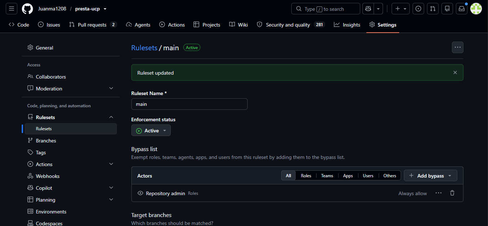
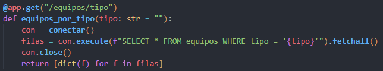
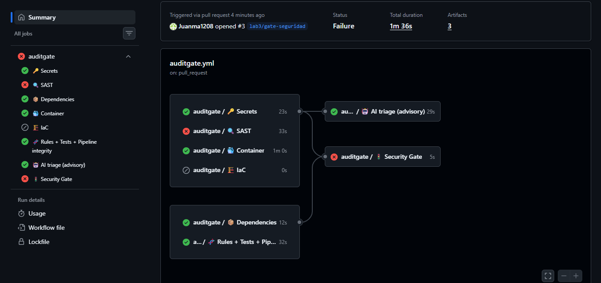
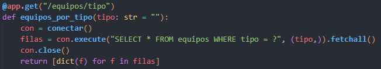
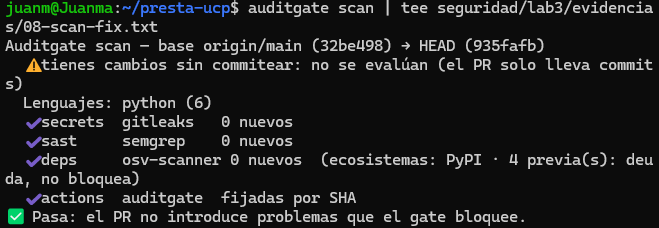
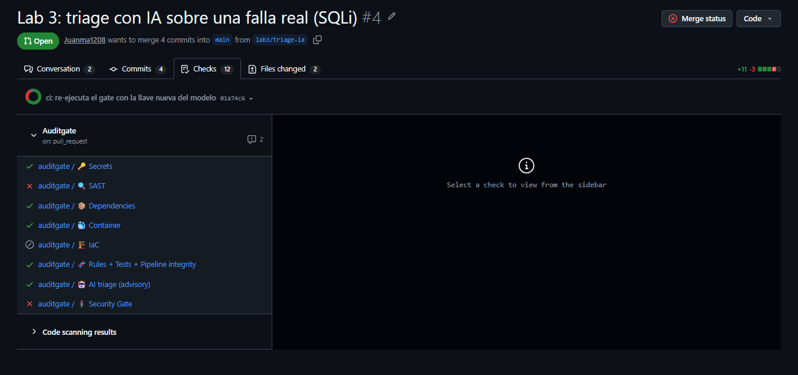
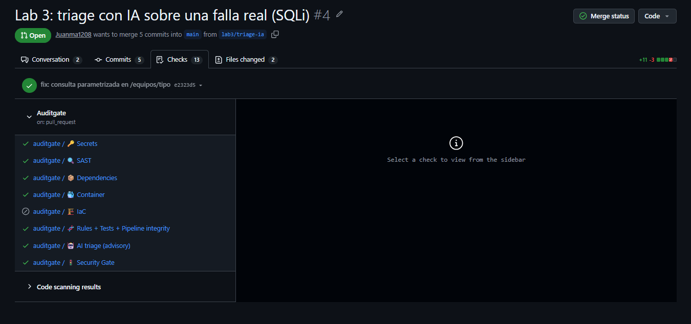
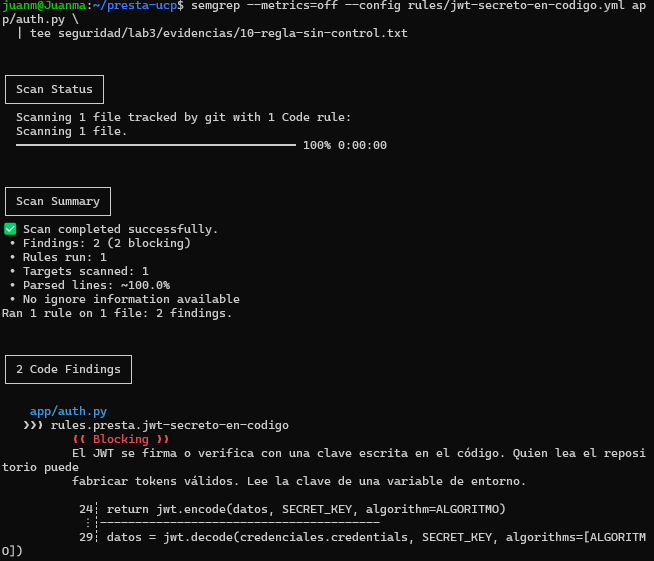
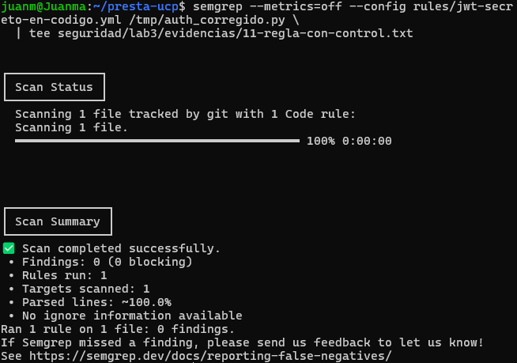
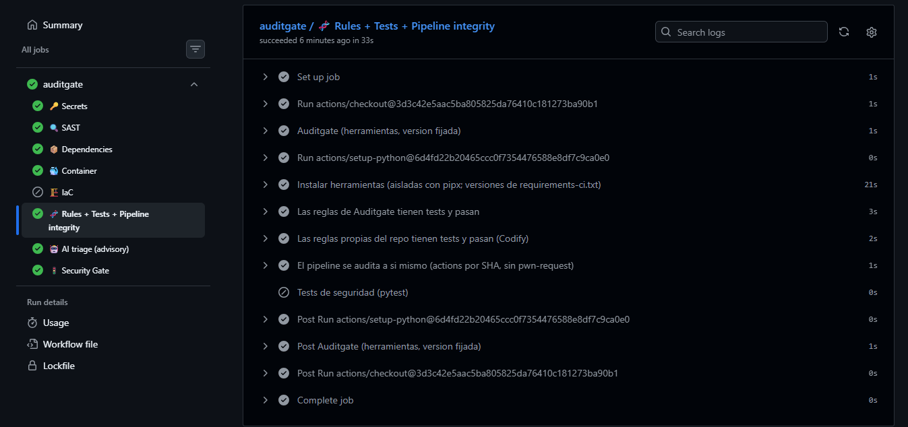

# Lab 3 · Un gate de seguridad en el pipeline · PrestaUCP

- **Herramienta:** Auditgate (`github.com/Jawy77/auditgate`), fijado por SHA `07faee3bc9092019a8543b6168f72f3b963afcb6`.
- **Qué hace:** en cada pull request corre Gitleaks (secretos), Semgrep (SAST), OSV-Scanner (dependencias) y el escaneo del contenedor, y **bloquea solo los hallazgos nuevos** respecto al merge-base con `main`. La deuda que ya existe en `main` no bloquea.
- **Triage con IA:** no se configuró modelo (`auditgate init` → opción 5, solo gate determinista). El gate bloquea igual; el triage de la sección 3 se hace a mano.
- **Restricción:** el PR #2 (`lab2/top5-correcciones`, correcciones del Lab 2) está pendiente de revisión y no se toca. El Lab 3 se trabaja en ramas nuevas desde `main`.

## 0. Preparación y práctica

Antes de instalar el gate en PrestaUCP se practicó con la demo de la sesión 4 (`demos/sesion-4/auditgate/`) en un repo local desechable (`~/demo-gate`):

1. Una rama `demo-busqueda` agregó `buscar.py` con una SQLi por f-string. El gate bloqueó con **2 hallazgos nuevos** sobre la misma línea: la regla propia `auditgate.flask.sqli-string-built-query` y la regla de taint `tainted-sql-string` de Semgrep. Son dos detecciones de una sola causa raíz.
2. Al cambiar el f-string por una consulta parametrizada (`?` y la tupla `(q,)`), el gate pasó a **0 nuevos** y `exit 0`. Un solo fix cerró las dos detecciones.

Problemas encontrados en el camino:

| Problema | Causa | Solución |
|---|---|---|
| Base y HEAD con el mismo SHA en el primer escaneo | El commit quedó en `main` en vez de en la rama | Rehacer el repo de práctica creando la rama antes del commit |
| `gitleaks falló: unknown command "git"` | El paquete de Debian trae gitleaks 8.16, que no tiene el subcomando `git` (existe desde la 8.19) | Instalar gitleaks 8.21.2 oficial en `~/.local/bin` |
| `osv-scanner error` al consultar dependencias | La red no alcanzaba `api.osv.dev` | Cambiar de red |

En los dos errores el gate respondió `⚠ Error` y no un verde: **nunca da un verde engañoso**.

## 1. Instalación del gate

- `auditgate init` detectó Python (6 archivos) y el `Dockerfile`, y generó `.github/workflows/auditgate.yml`.
- El workflow fija la versión por SHA (protección de la cadena de suministro) y usa permisos mínimos (`contents: read` por defecto).
- Se commiteó **solo** el workflow (commit `32be498`, `ci: instala Auditgate`). Un cambio a `.gitignore` que se había colado se sacó del commit porque es idéntico al del PR #2 y lo habría borrado de su diff.
- El archivo `.env` local no estaba en el `.gitignore` de `main`. Se ignoró solo en local con `.git/info/exclude`, porque la corrección ya está en el PR #2.

**Primer run en `main`** (run `44909694434`, evento `push`, 1 min 15 s):

| Job | Resultado |
|---|---|
| 🔑 Secrets | ✅ success |
| 📦 Dependencies | ✅ success |
| 🐳 Container | ✅ success |
| 🧬 Rules + Tests + Pipeline integrity | ✅ success |
| 🔍 SAST | ✅ success |
| 🏗️ IaC | ⏭ skipped (no hay Terraform) |
| 🚦 **Security Gate** | ✅ success |
| 🤖 AI triage (advisory) | ⏭ skipped (sin modelo) |


El run pasa porque en un push a `main` lo único nuevo era el workflow. El PR #2 no se vio afectado: su último commit sigue siendo `73c29fd` y no tiene checks corridos.


**Branch protection.** Se configuró con un *ruleset* de GitHub (la versión nueva de branch protection) llamado `main`:

| Opción | Valor | Por qué |
|---|---|---|
| Enforcement status | **Active** | Sin esto la regla existe pero no se aplica |
| Target branches | Rama por defecto (`main`) | Es la rama a la que llegan los PR |
| Require status checks to pass | **`auditgate / 🚦 Security Gate`** | El único check que decide el merge. Sin esto el gate avisa pero no bloquea |
| Require branches to be up to date | No | Evita forzar cambios en la rama del PR #2, que está pendiente de revisión |
| Block force pushes y bloqueo de borrado | Sí | Nadie puede reescribir ni borrar el historial de `main` |
| Bypass list | Repository admin | El dueño puede mergear el PR #2, que no tiene checks corridos, si el docente lo aprueba |

La regla no cambia el código de ninguna rama ni mergea nada sola: habilita o bloquea el botón de merge según el resultado del gate. Con la regla activa, el PR #3 queda en estado `CLEAN` (gate en verde, se puede mergear), mientras que un PR con un hallazgo nuevo queda bloqueado.

En el primer intento el ruleset quedó en `Disabled` y sin rama objetivo (*«This ruleset does not target any resources and will not be applied»*), así que no protegía nada. Se corrigió y se verificó con la API de GitHub que esté `active` sobre `~DEFAULT_BRANCH`.




- [x] Captura del workflow en el repo (`evidencias/02-workflow-main.png`)
- [x] Captura del primer run en `main` (`evidencias/01-pipeline-main.png`)
- [x] Captura de la regla de branch protection (`evidencias/16-branch-protection.png` y `evidencias/17-branch-protection.png`)

## Deuda vieja que el gate ve y no bloquea

Un `auditgate scan` local parado en `main` (base = HEAD) muestra lo que ya existe en el código:

| Hallazgo | Regla | Amenaza del Lab 1 |
|---|---|---|
| `app/auth.py:8` | `auditgate.python.hardcoded-credential` | T3: secreto del JWT en el código |
| `app/auth.py:24` | `jwt-python-hardcoded-secret` | T3 (la misma, por otra regla) |
| `app/main.py:108` | `auditgate.flask.sqli-string-built-query` | T1: SQLi en `GET /equipos?buscar=` |
| 4 vulnerabilidades en dependencias (PyPI) | OSV-Scanner: «previas: deuda, no bloquea» | No estaba en el top 5 |

Sin diff contra qué comparar, el SAST local marca todo como nuevo (fail-closed), mientras que OSV-Scanner ya separa las 4 vulnerabilidades como deuda. En CI, el push a `main` pasó en verde. Esta deuda se está corrigiendo en el PR #2; el gate evita que se **agregue** más.

En Code Scanning (pestaña *Security*) la deuda de `main` suma 281 alertas abiertas, y ninguna bloquea un PR porque no son nuevas:

| Herramienta | Alertas | Qué son |
|---|---|---|
| Trivy | 240 | Paquetes del sistema operativo con CVE dentro de la imagen base de Docker |
| Gitleaks | 33 | Tokens JWT y cabeceras `Authorization` copiados en las evidencias del Lab 2 (`seguridad/lab2/.../curl.txt` y `pytest.txt`) |
| Semgrep OSS y Bandit | 8 | T1 (`main.py:108`), T3 (`auth.py:8` y `auth.py:24`), el hash MD5 de las contraseñas (`auth.py:15`) y CORS con comodín (`main.py:31`) |

Los tokens de las evidencias se firmaron con el secreto `presta-ucp-2026`, que ya está expuesto en el código (T3), así que no abren un acceso nuevo. Aun así, queda como lección para el Entregable 2: las evidencias no deben llevar tokens sin redactar.

## 2. PR que el gate bloquea

**Antes de la falla.** En la rama `lab3/gate-seguridad`, con solo cambios de documentación respecto a `main` (base `32be498` → HEAD `e3b1978`), el gate pasa (`evidencias/03-scan-antes.txt`):

| Control | Resultado |
|---|---|
| secrets (gitleaks) | 0 nuevos |
| sast (semgrep) | 0 nuevos |
| deps (osv-scanner) | 0 nuevos · 4 previas: deuda, no bloquea |
| actions | fijadas por SHA |


Con un diff real contra la base, la SQLi de `main.py:108` y el secreto de `auth.py` ya no aparecen como nuevos: son deuda de `main`.

**La falla.** El commit `8facf14` (`feat: filtrar equipos por tipo`) agrega un endpoint nuevo, `GET /equipos/tipo`, que arma el SQL con un f-string. Es el mismo patrón de T1 (SQLi), en un lugar donde antes no existía:

```python
@app.get("/equipos/tipo")
def equipos_por_tipo(tipo: str = ""):
    con = conectar()
    filas = con.execute(f"SELECT * FROM equipos WHERE tipo = '{tipo}'").fetchall()
    con.close()
    return [dict(f) for f in filas]
```



**El gate local bloquea** (`evidencias/04-scan-falla.txt`, base `32be498` → HEAD `8facf14`):

```
✖ sast     semgrep    1 nuevo(s) — BLOQUEA
    app/main.py:115  auditgate.flask.sqli-string-built-query
🚫 Bloqueado: 1 hallazgo(s) nuevo(s).
```


Solo sale el hallazgo **nuevo** (`main.py:115`). La SQLi vieja de `main.py:108` sigue en el código pero no bloquea, porque ya estaba en `main`.

A diferencia de la demo en Flask, aquí la detecta **una sola regla**: la propia de Auditgate (`sqli-string-built-query`), que busca el patrón `execute(f"...")` sin importar el framework. La regla de taint del registro de Semgrep (`tainted-sql-string`) no la marca, porque reconoce como fuente `request.args` de Flask y no los parámetros de consulta de FastAPI.

**El gate en GitHub bloquea.** En el PR #3 (`lab3/gate-seguridad` → `main`):

| Check | Resultado | Qué es |
|---|---|---|
| 🚦 **Security Gate** | ❌ failure | El check que decide (será el requerido en branch protection) |
| 🔍 SAST | ❌ failure | El job de Semgrep encontró 1 hallazgo nuevo |
| Semgrep OSS | ❌ failure | La alerta subida a Code Scanning: `sqli-string-built-query` en `app/main.py:115` |
| 🔑 Secrets, 📦 Dependencies, 🐳 Container, 🧬 Rules + Tests | ✅ success | Sin hallazgos nuevos |
| gitleaks, Trivy, Hadolint | ✅ success | Resultados de Code Scanning de esos controles |
| 🤖 AI triage (advisory) | ✅ success | Corrió sin modelo configurado: no comenta |
| 🏗️ IaC | ⏭ skipped | No hay Terraform |

En Code Scanning, la única alerta abierta del PR sobre `app/main.py` es la de la línea 115. El gate no reporta como nueva la SQLi de la línea 108.




- [x] Captura de los checks del PR con el Security Gate en rojo (`evidencias/05-pr-checks-rojo.png`)
- [x] Captura de la alerta en `app/main.py:115` (`evidencias/06-alerta-sqli.png`)

## 3. Triage y corrección

En el PR #3 el agente de IA todavía no tenía modelo, así que el triage se hizo a mano con las mismas preguntas que responde el bot. Después se configuró el modelo y se repitió la falla en el PR #4 para comparar ambos triages (ver [Triage con el agente de IA](#triage-con-el-agente-de-ia-pr-4)).

| Pregunta | Respuesta |
|---|---|
| **Hallazgo** | `auditgate.flask.sqli-string-built-query` en `app/main.py:115` |
| **¿Verdadero o falso positivo?** | **Verdadero positivo.** `tipo` es un parámetro de consulta (`?tipo=`) que FastAPI entrega tal cual llega en la URL, sin validación, y el f-string lo pega dentro del SQL. Si el valor trae una comilla, cierra el string y lo que sigue se ejecuta como SQL |
| **¿Es alcanzable?** | **Sí, sin autenticación.** `GET /equipos/tipo` no tiene `Depends(usuario_actual)` ni `Depends(solo_admin)`, así que cualquier visitante anónimo de Internet lo puede llamar. Cruza el límite de confianza L1 del Lab 1 |
| **Impacto** | **Alto.** La tabla `equipos` tiene 4 columnas, así que un `UNION SELECT` de 4 columnas lee cualquier otra tabla. Con `?tipo=' UNION SELECT id, correo, clave, rol FROM usuarios--` la respuesta trae el correo, el hash de la contraseña y el rol de todas las cuentas, incluido el administrador. Es la misma consecuencia que T1 (T-17) del Lab 1 |
| **Severidad** | I × P = 3 × 3 = **9**, igual que T1: el mismo patrón, en un endpoint nuevo |
| **Fix** | Consulta parametrizada: el valor viaja aparte del SQL con `?` y una tupla, y SQLite lo trata como dato, nunca como código |

**Prueba de que es explotable.** Se llamó al endpoint con un cliente de pruebas de FastAPI sobre una base temporal (no la del proyecto):

| Petición | Respuesta |
|---|---|
| `GET /equipos/tipo?tipo=portatil` | `200`: los portátiles, como se espera |
| `GET /equipos/tipo?tipo=' UNION SELECT id, correo, clave, rol FROM usuarios--` | `200`: en el campo `nombre` salen los correos (`admin@presta.edu.co`, `ana@presta.edu.co`…), en `tipo` los hashes de las contraseñas (`0192023a…`) y en `disponible` el rol (`admin`, `estudiante`) |

El hallazgo no es teórico: un visitante sin cuenta extrae las credenciales de todos los usuarios con una sola petición.

**Requisito ASVS:** V1 (codificación y sanitización: las consultas a la base usan parámetros). Mitiga T1 (T-17) del Lab 1.

**El fix.** Se cambió solo la línea 115 de `app/main.py`:

```diff
-    filas = con.execute(f"SELECT * FROM equipos WHERE tipo = '{tipo}'").fetchall()
+    filas = con.execute("SELECT * FROM equipos WHERE tipo = ?", (tipo,)).fetchall()
```



**Prueba después del fix** (el mismo cliente de pruebas, sobre una base temporal):

| Petición | Antes | Después |
|---|---|---|
| `?tipo=portatil` | `200`, 2 equipos | `200`, 2 equipos: la búsqueda legítima sigue funcionando |
| `?tipo=' UNION SELECT id, correo, clave, rol FROM usuarios--` | `200`, correos, hashes y roles | `200`, `[]`: busca un equipo cuyo tipo sea literalmente ese texto y no encuentra ninguno |

**El gate pasa a verde.** Con el fix commiteado (`935fafb`), el scan local da `✅ Pasa` con `sast 0 nuevos` (`evidencias/08-scan-fix.txt`). Después del push, todos los checks del PR #3 pasan: **🚦 Security Gate ✅**, SAST, Semgrep OSS, Bandit, gitleaks, Trivy y Hadolint en verde, e IaC omitido.




Un primer intento del scan local siguió bloqueando porque el fix estaba guardado en disco pero no commiteado: el gate evalúa lo que entra al repositorio, no lo que hay en el editor.

- [x] Captura de los checks del PR en verde (`evidencias/10-pr-checks-verde.png`)

### Triage con el agente de IA (PR #4)

**Configuración del modelo.** Se usó el mismo proveedor de la práctica de `seclab`: Groq, con una API compatible con OpenAI. No se cambió el código, solo la configuración del repo en GitHub:

| Dónde | Nombre | Valor |
|---|---|---|
| Variable del repo | `AUDITGATE_LLM_PROVIDER` | `openai-compatible` |
| Variable del repo | `AUDITGATE_LLM_MODEL` | `openai/gpt-oss-120b` |
| Variable del repo | `AUDITGATE_LLM_BASE_URL` | `https://api.groq.com/openai/v1` |
| Secreto (Environment `auditgate` y repo) | `AUDITGATE_LLM_API_KEY` | La llave de Groq, cargada por stdin con `auditgate set-key --key-stdin` (nunca se escribió en pantalla ni en el repo) |

**Problema encontrado: la llave llegaba vacía.** Con la configuración de `auditgate init` (`secrets: inherit`), el job `🤖 AI triage` mostraba `AUDITGATE_LLM_API_KEY:` vacío y Groq respondía `401 Invalid API Key`. La razón es que `secrets: inherit` solo entrega secretos a un workflow reutilizable de la **misma organización**, y Auditgate es de otro dueño (`Jawy77/auditgate`). Se corrigió pasando la llave de forma explícita en el workflow del PR #4:

```diff
-    secrets: inherit
+    secrets:
+      AUDITGATE_LLM_API_KEY: ${{ secrets.AUDITGATE_LLM_API_KEY }}
```

Con ese cambio el log muestra `AUDITGATE_LLM_API_KEY: ***` (llega, y GitHub la enmascara). El cambio está solo en la rama del PR #4; `main` no se modificó.

**La falla, otra vez.** El [PR #4](https://github.com/Juanma1208/presta-ucp/pull/4) (`lab3/triage-ia` → `main`) repite el commit `feat: filtrar equipos por tipo` con la misma SQLi de `app/main.py:115`. El `🚦 Security Gate` bloquea y el agente comenta en el PR:

| # | Veredicto | Alcanzable | Regla | Ubicación | ¿Nuevo en el PR? |
|---|---|---|---|---|---|
| 0 | TP, confianza alta | sí | `wildcard-cors` | `app/main.py:31` | No (deuda de `main`) |
| 1 | TP, confianza alta | sí | `sqli-string-built-query` | `app/main.py:108` | No (deuda de `main`, T1) |
| 2 | TP, confianza alta | sí | `sqli-string-built-query` | `app/main.py:115` | **Sí: es la falla del PR** |

Para el hallazgo #2 el agente explicó que `/equipos/tipo` arma el SQL con un f-string usando el parámetro `tipo`, y sugirió exactamente el mismo fix que se aplicó a mano: `"SELECT * FROM equipos WHERE tipo = ?", (tipo,)`. También propuso convertir el patrón en una regla genérica (Extract → Codify).




**Después del fix.** Con la consulta parametrizada, todos los checks del PR #4 pasan y el agente actualiza su comentario: el hallazgo de la línea 115 desaparece y solo quedan el CORS y la SQLi de la línea 108, que son deuda de `main` y no bloquean. Esta vez el agente marcó uno de los dos hallazgos de la línea 108 como **duplicado**, porque Bandit (`B608`) y Semgrep reportan la misma SQLi.



- [x] Captura del comentario del triage (`evidencias/18-triage-ia-comentario.png`)
- [x] Captura del gate en rojo con el triage (`evidencias/19-pr4-gate-rojo-triage.png`)
- [x] Captura del gate en verde tras el fix (`evidencias/20-pr4-gate-verde.png`)

## 4. Regla propia con prueba

**Amenaza codificada:** T3 (T-02) del Lab 1, el secreto del JWT escrito en el código (`app/auth.py:8`). Con ese secreto, cualquiera que lea el repositorio puede firmar un token con `"rol": "admin"` y suplantar a cualquier usuario.

**El patrón, no el bug.** La regla no busca la línea `SECRET_KEY = "presta-ucp-2026"`, sino cualquier `jwt.encode(...)` o `jwt.decode(...)` cuya clave sea un texto fijo, escrito directo o guardado antes en una constante. Semgrep sigue el valor de la constante hasta la llamada (propagación de constantes), así que el nombre de la variable no importa.

| Archivo | Qué es |
|---|---|
| `rules/jwt-secreto-en-codigo.yml` | La regla `presta.jwt-secreto-en-codigo` (severidad `ERROR`, para que el gate bloquee) |
| `rules/jwt-secreto-en-codigo.py` | Los fixtures: 3 casos `# ruleid:` que debe marcar y 2 casos `# ok:` que no debe marcar |
| `.semgrepignore` | Excluye `rules/` y `tests/` del escaneo, para que el fixture vulnerable no bloquee el PR |

```yaml
pattern-either:
  - pattern: jwt.encode($DATOS, "...", ...)
  - pattern: jwt.decode($TOKEN, "...", ...)
```

**Los fixtures:**

| Caso | Marca | Por qué |
|---|---|---|
| `jwt.encode(datos, "presta-ucp-2026", ...)` | `ruleid` | Clave literal en la llamada |
| `jwt.encode(datos, SECRET_KEY, ...)` con `SECRET_KEY = "..."` | `ruleid` | Clave en una constante: el caso real de PrestaUCP |
| `jwt.decode(token, CLAVE_FIRMA, ...)` con `CLAVE_FIRMA = "..."` | `ruleid` | Mismo patrón con un nombre en español |
| `jwt.encode(datos, os.environ["JWT_SECRET"], ...)` | `ok` | La clave viene del entorno |
| `jwt.decode(token, CLAVE_ENTORNO, ...)` con `CLAVE_ENTORNO = os.environ[...]` | `ok` | Constante, pero leída del entorno: no es un falso positivo |

**La prueba:** `semgrep --test --metrics=off rules/` → `1/1: ✓ All tests passed`. El job `🧬 Rules + Tests` de Auditgate corre la misma prueba en cada PR y bloquea si falla.

**Falla sin el control, pasa con él:**

| Código | Hallazgos de la regla | Evidencia |
|---|---|---|
| `app/auth.py` de `main` (secreto en el código) | **2**: `jwt.encode` en la línea 24 y `jwt.decode` en la 29 | `evidencias/11-regla-sin-control.txt` |
| `app/auth.py` del PR #2 (secreto desde `JWT_SECRET`, mínimo 32 bytes) | **0** | `evidencias/12-regla-con-control.txt` |





**Por qué hacía falta una regla propia.** La regla genérica de Auditgate, `auditgate.python.hardcoded-credential`, decide por el **nombre** de la variable (`secret`, `password`, `token`, `api_key`…). Sobre los mismos fixtures marca `SECRET_KEY` pero **no** `CLAVE_FIRMA`: basta con nombrar la clave en español para esquivarla. La regla propia mira **dónde se usa** el valor (que llegue a `jwt.encode` o `jwt.decode`) y atrapa las dos variantes.


**Trazabilidad:**

| Amenaza (Lab 1) | Requisito ASVS 5.0 | Control | Prueba | Gate |
|---|---|---|---|---|
| T3 (T-02): secreto del JWT en el código, STRIDE S, 3 × 3 = 9 | V13 (secretos fuera del código) y V9 (tokens autocontenidos) | Regla `presta.jwt-secreto-en-codigo` | `semgrep --test rules/` con 3 `ruleid` y 2 `ok` | Job `🧬 Rules + Tests` y SAST del `🚦 Security Gate` |

La corrección del código en sí está en el PR #2 (Lab 2). Esta regla evita que el patrón vuelva a entrar.

**En CI.** Con la regla en el PR #3 (run `44922285712`), el job `🧬 Rules + Tests + Pipeline integrity` ejecutó el paso **«Las reglas propias del repo tienen tests y pasan (Codify)» → success**, y el `🚦 Security Gate` siguió en verde. La regla sí ve `auth.py:24` y `auth.py:29`, pero no bloquea porque esos hallazgos ya existían en `main`: son deuda que corrige el PR #2. El fixture vulnerable no se escanea gracias a `.semgrepignore`.




## 5. Reflexión

**¿Qué hallazgo bloqueó el gate que una persona habría dejado pasar?** La SQLi del endpoint nuevo `GET /equipos/tipo` (`app/main.py:115`), el mismo patrón de T1. El commit se llamaba `feat: filtrar equipos por tipo` y copiaba la forma de `listar_equipos`, que ya estaba en el archivo, por eso en una revisión se veía como código normal. Aun así, el endpoint no pedía autenticación y un visitante anónimo podía sacar el correo, el hash de la contraseña y el rol de todas las cuentas con una sola petición.

**¿El triage acertó en el verdadero o falso positivo?** Sí. El agente de IA (`gpt-oss-120b` vía Groq) marcó la SQLi de `main.py:115` como verdadero positivo alcanzable y sugirió el mismo fix que se aplicó a mano, que antes se había comprobado con una prueba de concepto: el `UNION SELECT` devolvía las credenciales y, con la consulta parametrizada, la misma petición devolvió `[]`. Aun así, el agente no separa lo nuevo de lo viejo: también comentó como verdaderos positivos el CORS y la SQLi de la línea 108, que son deuda de `main`. Por eso el que decide es el gate y no la IA. Además hubo un vacío: la regla de taint de Semgrep está hecha para Flask y no marcó la falla en FastAPI, y por eso se escribió una regla propia para T3 que no depende del nombre de la variable.

**¿Qué deuda vieja dejó pasar el gate y por qué está bien?** Dejó pasar la SQLi de `GET /equipos?buscar=` (T1, `main.py:108`), el secreto del JWT (T3, `auth.py:8`) y 4 vulnerabilidades en dependencias, porque ya estaban en `main` y no las introdujo el PR. Está bien porque, si el gate bloqueara la deuda vieja, ningún PR se podría mergear hasta arreglar todo, y el equipo terminaría ignorándolo. La deuda sigue visible en Code Scanning y su corrección está en el PR #2, mientras que el gate evita que se agregue más.

## Entrega

| Pide la guía | Dónde está |
|---|---|
| 1. Workflow `auditgate.yml` commiteado y branch protection con `Security Gate` requerido | `.github/workflows/auditgate.yml` en `main` (commit `32be498`) · sección 1 · `evidencias/02`, `16` y `17` |
| 2. PR bloqueado por el gate y luego en verde tras el fix | [PR #3](https://github.com/Juanma1208/presta-ucp/pull/3) · secciones 2 y 3 · `evidencias/05`, `06`, `10` y `14` |
| 3. Regla con dos fixtures y la prueba que pasa | `rules/jwt-secreto-en-codigo.yml` y `rules/jwt-secreto-en-codigo.py` · sección 4 · `evidencias/11`, `12`, `13` y `15` |
| Triage con el agente de IA | [PR #4](https://github.com/Juanma1208/presta-ucp/pull/4) · sección 3 (Triage con el agente de IA) · `evidencias/18`, `19` y `20` |
| 4. Tres líneas de reflexión | Sección 5 |

Los PR #3 y #4 quedan abiertos como evidencia y no se mergean por ahora. El PR #2 (Lab 2) no se modificó en ningún paso de este laboratorio.
