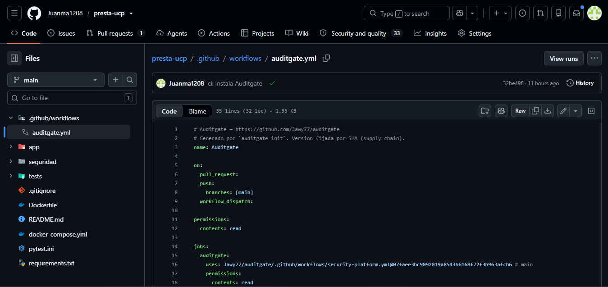
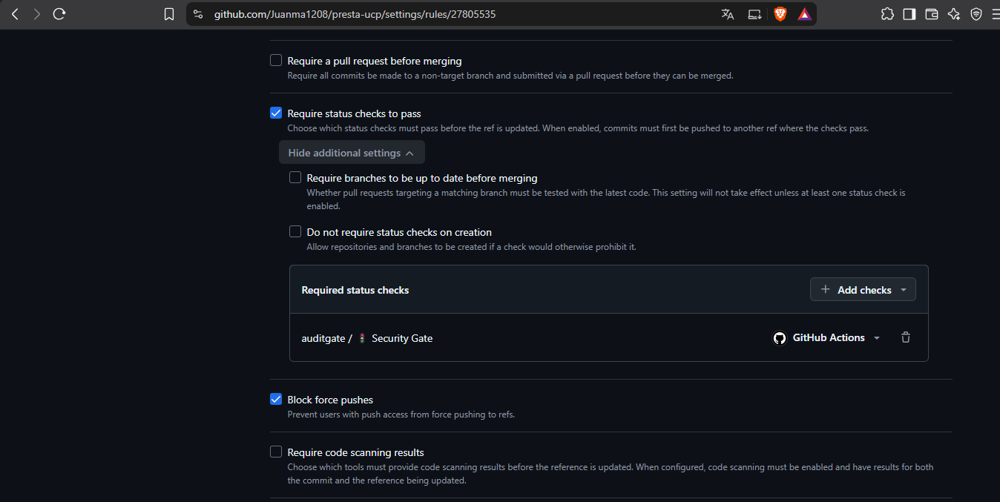
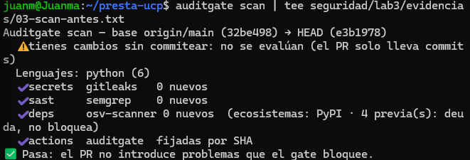
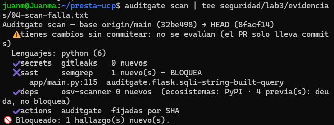
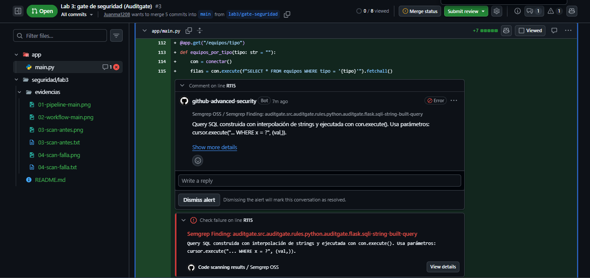
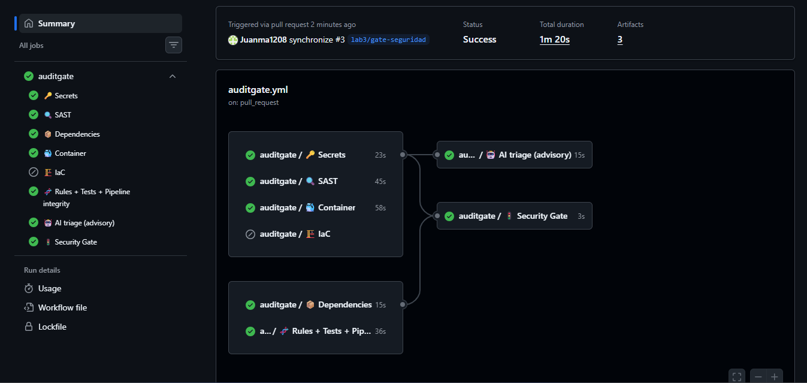
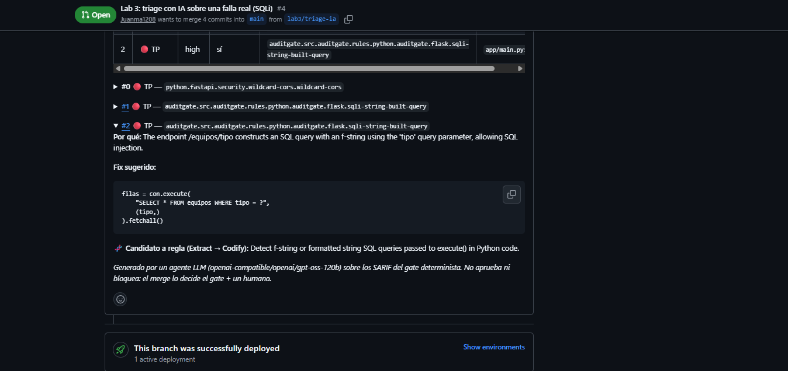
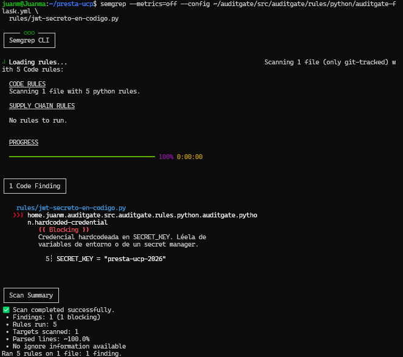
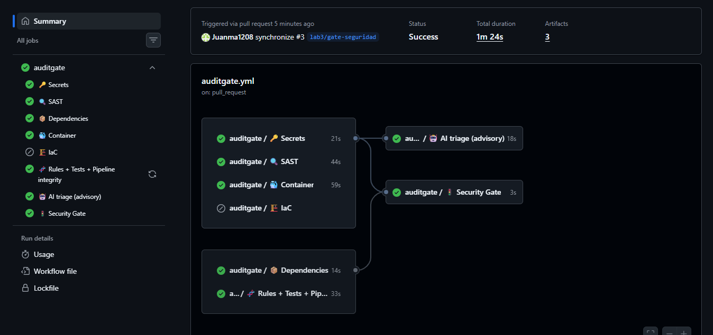

# Lab 3 · Gate de seguridad en el pipeline · PrestaUCP

## Introducción

En el Lab 1 se identificaron las amenazas de PrestaUCP y en el Lab 2 se verificaron con ASVS, Semgrep y ZAP, ejecutando las herramientas a mano. El problema de ese enfoque es que depende de que alguien se acuerde de correrlas: si mañana entra una consulta insegura, nada la detiene.

En este laboratorio se agregó un gate de seguridad al pipeline con **Auditgate**, fijado a una versión específica. En cada pull request revisa secretos (Gitleaks), código (Semgrep), dependencias (OSV-Scanner) y el contenedor, y bloquea el merge solo si el cambio introduce un hallazgo **nuevo** respecto a main. La deuda que ya existía no bloquea.

Todo el trabajo se hizo en ramas nuevas creadas desde main. El PR #2, con las correcciones del Lab 2, está pendiente de revisión y no se modificó.

## Pruebas previas

Antes de instalarlo en PrestaUCP, Auditgate se probó con la demo de la sesión 4 en un repositorio local de prueba. En una rama se agregó un archivo con una consulta SQL armada con f-string. El gate bloqueó con **2 hallazgos nuevos** en la misma línea, uno de la regla propia de Auditgate y otro de la regla de taint de Semgrep. Al cambiarla por una consulta parametrizada, el gate pasó.

En esas pruebas aparecieron tres errores. El primero fue que la base y el HEAD tenían el mismo SHA, porque el commit quedó en main y no en la rama; se rehízo el repositorio creando la rama primero. El segundo fue que gitleaks no reconocía un subcomando, porque la versión que trae Ubuntu es antigua; se instaló una versión más reciente. El tercero fue un error de OSV-Scanner porque la red no alcanzaba su servidor, y se resolvió cambiando de red.

En los dos últimos casos el gate respondió Error en lugar de un verde. Es decir, cuando no puede revisar, no deja pasar el cambio.

## 1. Instalación del gate

El workflow del gate se generó con el comando auditgate init, que detectó que el proyecto es Python y que tiene un Dockerfile. Se subió a main en un commit que solo contiene ese archivo. En el commit se había colado un cambio al .gitignore, pero se sacó porque es el mismo que ya trae el PR #2 y, si entraba a main, ese cambio desaparecía del diff del PR.

El workflow fija la versión exacta de Auditgate en lugar de usar siempre la última. Así, si el repositorio de Auditgate cambia, el pipeline de PrestaUCP no cambia con él. Además, los permisos por defecto son solo de lectura.

La primera ejecución en main pasó en verde, ya que lo único nuevo era el workflow. El job de triage con IA quedó omitido porque en ese momento no tenía modelo configurado.




Para que el gate bloquee de verdad, se creó un *ruleset* sobre main con auditgate / Security Gate como check requerido. Sin él, el PR sale en rojo pero el botón de merge sigue disponible. La configuración quedó así:

| Opción | Valor | Motivo |
|---|---|---|
| Enforcement status | Active | Si está inactivo, la regla no se aplica |
| Target branches | Rama por defecto (main) | Es la rama a la que llegan los PR |
| Required status check | auditgate / Security Gate | Es el único check que decide el merge |
| Require branches to be up to date | No | Para no obligar a actualizar la rama del PR #2 |
| Block force pushes y borrado | Sí | Protege el historial de main |
| Bypass list | Repository admin | Para poder mergear el PR #2 si el docente lo aprueba, ya que no tiene checks corridos |

En el primer intento el ruleset quedó en Disabled y sin rama objetivo, así que no protegía nada. Se corrigió y se confirmó que quedara activo sobre main.




### Deuda que ya existía en main

main todavía tiene el código vulnerable del Lab 1, porque las correcciones están en el PR #2. Un auditgate scan local sobre main mostró:

| Hallazgo | Herramienta | Amenaza del Lab 1 |
|---|---|---|
| Secreto del JWT escrito en el código | Semgrep (dos reglas distintas) | T3 |
| SQLi en la búsqueda de equipos | Semgrep | T1 |
| 4 vulnerabilidades en dependencias | OSV-Scanner | Fuera del top 5 |

En Code Scanning, la deuda de main suma 281 alertas: 240 de Trivy (paquetes del sistema operativo de la imagen base), 33 de Gitleaks y 8 de Semgrep y Bandit (T1, T3, el hash MD5 de las contraseñas y el CORS con comodín). Ninguna bloquea un PR porque ninguna es nueva.

Las 33 de Gitleaks fueron un descuido del Lab 2: son tokens JWT que quedaron copiados en las evidencias. Se firmaron con el secreto del JWT, que ya está expuesto en el código (T3), así que no abren un acceso nuevo. Aun así, las evidencias no deberían llevar tokens sin redactar.

## 2. Pull request bloqueado por el gate

Primero se corrió el gate en la rama del laboratorio cuando solo tenía documentación. Pasó con 0 hallazgos nuevos en secretos, código y dependencias, y las 4 vulnerabilidades de dependencias salieron como deuda. A diferencia del escaneo sobre main, aquí la SQLi de la línea 108 y el secreto del JWT ya no aparecen, porque al haber un diff contra la base se reconocen como deuda.



Para la falla se buscó algo que de verdad podría pasar en el proyecto. Se agregó un endpoint nuevo para filtrar equipos por tipo que arma el SQL con un f-string. Es el mismo patrón de T1, pero en un lugar nuevo:


El gate local bloqueó con un solo hallazgo nuevo, el de la línea 115:



La SQLi de la línea 108 sigue en el archivo, pero no bloquea porque ya estaba en main.

En las pruebas previas la falla la detectaron dos reglas, y aquí solo una, la de Auditgate, que busca el patrón sin importar el framework. La regla de taint de Semgrep no la marcó porque está pensada para Flask y no reconoce los parámetros de FastAPI. Es decir, una herramienta puede dejar pasar una falla solo por el framework que se use.

En GitHub, el PR #3 quedó con Security Gate y SAST en rojo, y Code Scanning reportó la alerta de SQLi en la línea 115. Los demás jobs (secretos, dependencias, contenedor y reglas) pasaron, y el de IaC se omitió porque el proyecto no tiene Terraform. La línea 108 no aparece como alerta nueva.




## 3. Triage y corrección

### Triage manual (PR #3)

En el PR #3 el agente de IA todavía no tenía modelo, así que el triage se hizo a mano.

El hallazgo es un **verdadero positivo**. El parámetro tipo llega desde la URL y FastAPI lo entrega tal cual, sin validar, así que el f-string lo pega directamente dentro del SQL. Si el valor trae una comilla, cierra el texto y lo que sigue se ejecuta como SQL.

Además es **alcanzable sin autenticación**: el endpoint no exige iniciar sesión ni tener un rol, así que cualquier visitante lo puede llamar, y cruza el límite de confianza L1 del Lab 1. El impacto es alto, porque la tabla equipos tiene 4 columnas y con un UNION SELECT de 4 columnas se puede leer cualquier otra tabla. La severidad queda en I × P = 3 × 3 = **9**, igual que T1.

Para confirmarlo se llamó al endpoint con el cliente de pruebas de FastAPI, sobre una base temporal y no la del proyecto:

| Petición | Respuesta |
|---|---|
| GET /equipos/tipo?tipo=portatil | 200: los portátiles, como se espera |
| GET /equipos/tipo?tipo=' UNION SELECT id, correo, clave, rol FROM usuarios-- | 200: en nombre salen los correos (admin@presta.edu.co, ana@presta.edu.co…), en tipo los hashes de las contraseñas (0192023a…) y en disponible el rol (admin, estudiante) |

Con una sola petición, alguien sin cuenta obtiene las credenciales de todos los usuarios, incluido el administrador.

### Corrección

El fix fue usar una consulta parametrizada, que corresponde al requisito ASVS V1 (las consultas a la base usan parámetros). Así el valor viaja separado del SQL y SQLite lo trata como dato, nunca como código. Solo cambió la línea 115:


Con las mismas dos peticiones, ?tipo=portatil siguió devolviendo los 2 portátiles, y la del UNION SELECT devolvió [], porque ahora busca un equipo cuyo tipo sea literalmente ese texto.

Con el fix commiteado, el scan local pasó sin hallazgos nuevos, y en GitHub todos los checks del PR #3 pasaron a verde. El primer scan después del cambio siguió bloqueando porque el fix estaba guardado pero no commiteado: el gate revisa lo que entra al repositorio, no lo que hay en el editor.




### Triage con el agente de IA (PR #4)

Después se configuró un modelo para el agente de triage. Se usó Groq con openai/gpt-oss-120b, el mismo de la práctica de seclab, porque es gratuito y tiene una API compatible con OpenAI. Se configuró con variables del repositorio para el proveedor y el modelo, y la llave se guardó como secreto de GitHub, de forma que no apareciera en pantalla ni en el repositorio.

La primera vez el agente respondió 401 Invalid API Key, y el log mostraba la llave vacía. La llave funcionaba en local, así que el problema estaba en cómo llegaba al job. La causa era la opción secrets: inherit que genera Auditgate al instalarse, que solo entrega secretos a workflows reutilizables de la misma organización, y Auditgate es de otro dueño. Se resolvió pasando la llave de forma explícita:

```diff
-    secrets: inherit
+    secrets:
+      AUDITGATE_LLM_API_KEY: ${{ secrets.AUDITGATE_LLM_API_KEY }}
```

Este cambio solo está en la rama del PR #4; main no se modificó.

El PR #4 repite la misma falla del endpoint de filtrar por tipo. El gate bloqueó y el agente comentó tres hallazgos:

| # | Veredicto | Hallazgo | Ubicación | ¿Nuevo en el PR? |
|---|---|---|---|---|
| 0 | Verdadero positivo, alcanzable | CORS con comodín | Configuración de la app | No, deuda de main |
| 1 | Verdadero positivo, alcanzable | SQLi | Búsqueda de equipos (línea 108) | No, deuda de main (T1) |
| 2 | Verdadero positivo, alcanzable | SQLi | Filtrar por tipo (línea 115) | **Sí** |

Para el hallazgo de la línea 115, el agente explicó que el parámetro tipo se concatena en el SQL y propuso exactamente el mismo fix que se aplicó a mano: la consulta parametrizada.




Con el fix, el PR #4 pasó a verde y el agente actualizó su comentario: la línea 115 desapareció y solo quedaron el CORS y la SQLi de la línea 108. Esta vez marcó uno de los hallazgos de la 108 como duplicado, y tenía razón, porque Bandit y Semgrep reportan la misma SQLi.


## 4. Regla propia para T3

Se eligió la amenaza T3 del Lab 1: el secreto del JWT escrito en el código. Es una de las más graves del top 5, porque con ese secreto cualquiera que lea el repositorio puede firmar un token con "rol": "admin" y hacerse pasar por cualquier usuario.

Una regla que solo buscara esa línea exacta serviría para este archivo y nada más. Por eso la regla busca cualquier firma o verificación de un JWT cuya clave sea un texto fijo, escrito directamente o guardado antes en una constante. Semgrep sigue el valor de la constante hasta la llamada, así que el nombre de la variable no importa.

```yaml
pattern-either:
  - pattern: jwt.encode($DATOS, "...", ...)
  - pattern: jwt.decode($TOKEN, "...", ...)
```

La regla tiene severidad alta para que el gate bloquee, y viene con un archivo de fixtures con los casos de prueba. Además, se excluyó la carpeta de reglas del escaneo normal; si no, el fixture vulnerable bloquearía el propio PR.

| Caso del fixture | Marca | Motivo |
|---|---|---|
| jwt.encode(datos, "presta-ucp-2026", ...) | ruleid | Clave escrita en la llamada |
| jwt.encode(datos, SECRET_KEY, ...) con SECRET_KEY = "..." | ruleid | Clave en una constante, que es el caso real de PrestaUCP |
| jwt.decode(token, CLAVE_FIRMA, ...) con CLAVE_FIRMA = "..." | ruleid | El mismo patrón con un nombre en español |
| jwt.encode(datos, os.environ["JWT_SECRET"], ...) | ok | La clave viene del entorno |
| jwt.decode(token, CLAVE_ENTORNO, ...) con CLAVE_ENTORNO = os.environ[...] | ok | Es una constante, pero leída del entorno; marcarla sería un falso positivo |

La prueba de la regla pasa: marca los tres casos vulnerables y no marca los dos seguros. Sobre el código de main la regla encuentra **2 hallazgos**, uno al firmar el token y otro al verificarlo, y sobre el código corregido del PR #2, que lee el secreto desde una variable de entorno, encuentra **0**. Para este segundo caso se escaneó una copia del archivo del PR #2, sin modificar esa rama.


Se escribió una regla propia porque la que ya trae Auditgate decide por el **nombre** de la variable (secret, password, token…). Sobre los mismos fixtures marca SECRET_KEY, pero no CLAVE_FIRMA, así que basta con nombrar la clave en español para esquivarla. La regla propia se fija en **dónde se usa** el valor y detecta las dos.



| Amenaza (Lab 1) | Requisito ASVS 5.0 | Control | Prueba | Gate |
|---|---|---|---|---|
| T3: secreto del JWT en el código, STRIDE S, 3 × 3 = 9 | V13 (secretos fuera del código) y V9 (tokens autocontenidos) | Regla propia | Fixtures con 3 casos vulnerables y 2 seguros | Job de reglas y SAST del Security Gate |

En el PR #3, el job de reglas del pipeline ejecutó la prueba de las reglas propias con éxito, y el gate siguió en verde. La regla sí ve el secreto en el código de main, pero no bloquea porque ya estaban en main. La corrección de ese código está en el PR #2; la regla evita que el patrón vuelva a entrar.




## 5. Reflexión

**¿Qué hallazgo bloqueó el gate que una persona habría dejado pasar?** La SQLi del endpoint nuevo para filtrar equipos por tipo. El cambio parecía una funcionalidad normal y copiaba la forma de la búsqueda de equipos, que ya estaba en el archivo, así que en una revisión se veía como código normal. Sin embargo, el endpoint no pedía autenticación, y cualquier visitante podía sacar el correo, el hash de la contraseña y el rol de todas las cuentas con una sola petición.

**¿El triage acertó en el verdadero o falso positivo?** Sí. El agente marcó la SQLi de la línea 115 como verdadero positivo alcanzable y propuso el mismo fix que se aplicó a mano, que antes se había comprobado con el UNION SELECT. Lo que no hace bien es separar lo nuevo de lo viejo: también comentó el CORS y la SQLi de la línea 108, que son deuda de main. Por eso tiene sentido que el que decide sea el gate y no la IA. También apareció un vacío en las herramientas: la regla de taint de Semgrep no vio la falla en FastAPI, y por eso la regla de T3 se diseñó para no depender del nombre de la variable.

**¿Qué deuda vieja dejó pasar el gate y por qué está bien?** Dejó pasar la SQLi de la búsqueda de equipos (T1), el secreto del JWT (T3) y 4 vulnerabilidades de dependencias, porque ya estaban en main y no las introdujo el PR. Está bien así: si el gate bloqueara la deuda vieja, ningún PR se podría mergear hasta arreglar todo, y al final el equipo terminaría ignorándolo. La deuda sigue visible en Code Scanning y su corrección está en el PR #2, mientras que el gate evita que entre más.

## Enlaces

- PR #3, gate en rojo y luego en verde, y regla propia: <https://github.com/Juanma1208/presta-ucp/pull/3>
- PR #4, triage con el agente de IA: <https://github.com/Juanma1208/presta-ucp/pull/4>
- Workflow del gate: .github/workflows/auditgate.yml en main
- Regla y fixtures: rules/jwt-secreto-en-codigo.yml y rules/jwt-secreto-en-codigo.py

Los PR #3 y #4 quedan abiertos y sin mergear.
