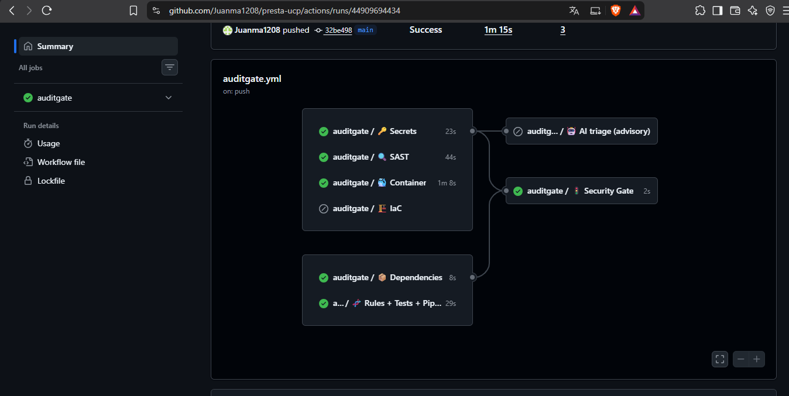

# Lab 3 · Un gate de seguridad en el pipeline · PrestaUCP

- **Herramienta:** Auditgate (`github.com/Jawy77/auditgate`), fijado por SHA `07faee3bc9092019a8543b6168f72f3b963afcb6`.
- **Qué hace:** en cada pull request corre Gitleaks (secretos), Semgrep (SAST), OSV-Scanner (dependencias) y el escaneo del contenedor, y **bloquea solo los hallazgos nuevos** respecto al merge-base con `main`. La deuda que ya existe en `main` no bloquea.
- **Triage con IA:** no se configuró modelo (`auditgate init` → opción 5, solo gate determinista). El gate bloquea igual; el triage de la sección 3 se hace a mano.
- **Restricción:** el PR #2 (`lab2/top5-correcciones`, correcciones del Lab 2) está pendiente de revisión y no se toca. El Lab 3 se trabaja en ramas nuevas desde `main`.

## 0. Preparación y práctica

Antes de instalar el gate en PrestaUCP se practicó con la demo de la sesión 4 (`demos/sesion-4/auditgate/`) en un repo local desechable (`~/demo-gate`):

1. Una rama `demo-busqueda` agregó `buscar.py` con una SQLi por f-string. El gate bloqueó con **2 hallazgos nuevos** sobre la misma línea: la regla propia `auditgate.flask.sqli-string-built-query` y la regla de taint `tainted-sql-string` de Semgrep. Son dos detecciones de una sola causa raíz.
2. Al cambiar el f-string por una consulta parametrizada (`?` y la tupla `(q,)`), el gate pasó a **0 nuevos** y `exit 0`. Un solo fix cerró las dos detecciones.

Problemas encontrados en el camino:

| Problema | Causa | Solución |
|---|---|---|
| Base y HEAD con el mismo SHA en el primer escaneo | El commit quedó en `main` en vez de en la rama | Rehacer el repo de práctica creando la rama antes del commit |
| `gitleaks falló: unknown command "git"` | El paquete de Debian trae gitleaks 8.16, que no tiene el subcomando `git` (existe desde la 8.19) | Instalar gitleaks 8.21.2 oficial en `~/.local/bin` |
| `osv-scanner error` al consultar dependencias | La red no alcanzaba `api.osv.dev` | Cambiar de red |

En los dos errores el gate respondió `⚠ Error` y no un verde: **nunca da un verde engañoso**.

## 1. Instalación del gate

- `auditgate init` detectó Python (6 archivos) y el `Dockerfile`, y generó `.github/workflows/auditgate.yml`.
- El workflow fija la versión por SHA (protección de la cadena de suministro) y usa permisos mínimos (`contents: read` por defecto).
- Se commiteó **solo** el workflow (commit `32be498`, `ci: instala Auditgate`). Un cambio a `.gitignore` que se había colado se sacó del commit porque es idéntico al del PR #2 y lo habría borrado de su diff.
- El archivo `.env` local no estaba en el `.gitignore` de `main`. Se ignoró solo en local con `.git/info/exclude`, porque la corrección ya está en el PR #2.

**Primer run en `main`** (run `44909694434`, evento `push`, 1 min 15 s):

| Job | Resultado |
|---|---|
| 🔑 Secrets | ✅ success |
| 📦 Dependencies | ✅ success |
| 🐳 Container | ✅ success |
| 🧬 Rules + Tests + Pipeline integrity | ✅ success |
| 🔍 SAST | ✅ success |
| 🏗️ IaC | ⏭ skipped (no hay Terraform) |
| 🚦 **Security Gate** | ✅ success |
| 🤖 AI triage (advisory) | ⏭ skipped (sin modelo) |



El run pasa porque en un push a `main` lo único nuevo era el workflow. El PR #2 no se vio afectado: su último commit sigue siendo `73c29fd` y no tiene checks corridos.

**Branch protection:** pendiente. Al marcar `auditgate / 🚦 Security Gate` como check requerido, el PR #2 quedaría bloqueado esperando el check, así que se activará cuando el PR #2 esté revisado. No se marcará *Require branches to be up to date*, para no forzar cambios en la rama del PR #2.


- [x] Captura del workflow en el repo (`evidencias/02-workflow-main.png`)
- [x] Captura del primer run en `main` (`evidencias/01-pipeline-main.png`)
- [ ] Captura de la regla de branch protection

## Deuda vieja que el gate ve y no bloquea

Un `auditgate scan` local parado en `main` (base = HEAD) muestra lo que ya existe en el código:

| Hallazgo | Regla | Amenaza del Lab 1 |
|---|---|---|
| `app/auth.py:8` | `auditgate.python.hardcoded-credential` | T3: secreto del JWT en el código |
| `app/auth.py:24` | `jwt-python-hardcoded-secret` | T3 (la misma, por otra regla) |
| `app/main.py:108` | `auditgate.flask.sqli-string-built-query` | T1: SQLi en `GET /equipos?buscar=` |
| 4 vulnerabilidades en dependencias (PyPI) | OSV-Scanner: «previas: deuda, no bloquea» | No estaba en el top 5 |

Sin diff contra qué comparar, el SAST local marca todo como nuevo (fail-closed), mientras que OSV-Scanner ya separa las 4 vulnerabilidades como deuda. En CI, el push a `main` pasó en verde. Esta deuda se está corrigiendo en el PR #2; el gate evita que se **agregue** más.

## 2. PR que el gate bloquea

**Antes de la falla.** En la rama `lab3/gate-seguridad`, con solo cambios de documentación respecto a `main` (base `32be498` → HEAD `e3b1978`), el gate pasa (`evidencias/03-scan-antes.txt`):

| Control | Resultado |
|---|---|
| secrets (gitleaks) | 0 nuevos |
| sast (semgrep) | 0 nuevos |
| deps (osv-scanner) | 0 nuevos · 4 previas: deuda, no bloquea |
| actions | fijadas por SHA |

Con un diff real contra la base, la SQLi de `main.py:108` y el secreto de `auth.py` ya no aparecen como nuevos: son deuda de `main`.

**La falla.** El commit `8facf14` (`feat: filtrar equipos por tipo`) agrega un endpoint nuevo, `GET /equipos/tipo`, que arma el SQL con un f-string. Es el mismo patrón de T1 (SQLi), en un lugar donde antes no existía:

```python
@app.get("/equipos/tipo")
def equipos_por_tipo(tipo: str = ""):
    con = conectar()
    filas = con.execute(f"SELECT * FROM equipos WHERE tipo = '{tipo}'").fetchall()
    con.close()
    return [dict(f) for f in filas]
```

**El gate local bloquea** (`evidencias/04-scan-falla.txt`, base `32be498` → HEAD `8facf14`):

```
✖ sast     semgrep    1 nuevo(s) — BLOQUEA
    app/main.py:115  auditgate.flask.sqli-string-built-query
🚫 Bloqueado: 1 hallazgo(s) nuevo(s).
```


Solo sale el hallazgo **nuevo** (`main.py:115`). La SQLi vieja de `main.py:108` sigue en el código pero no bloquea, porque ya estaba en `main`.

A diferencia de la demo en Flask, aquí la detecta **una sola regla**: la propia de Auditgate (`sqli-string-built-query`), que busca el patrón `execute(f"...")` sin importar el framework. La regla de taint del registro de Semgrep (`tainted-sql-string`) no la marca, porque reconoce como fuente `request.args` de Flask y no los parámetros de consulta de FastAPI.

_Pendiente: el PR en GitHub._

## 3. Triage y corrección

_Pendiente._

## 4. Regla propia con prueba

_Pendiente._

## 5. Reflexión

_Pendiente._
