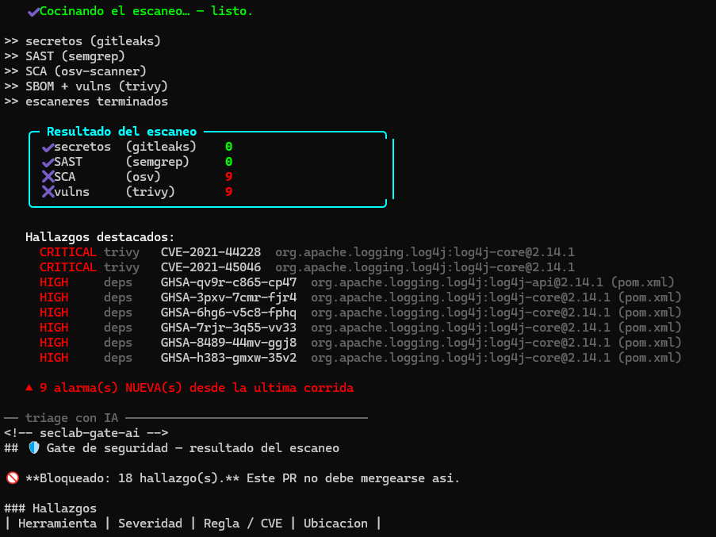
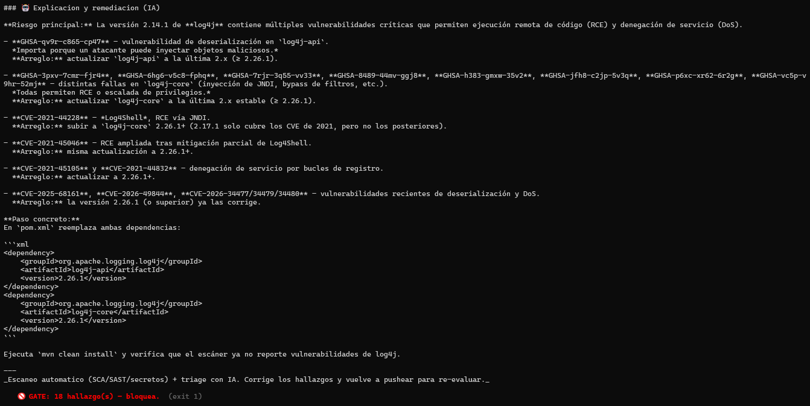
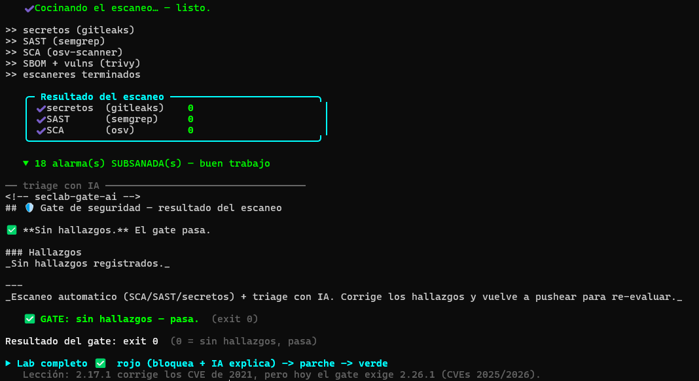

# Seclab · Gate de seguridad con IA sobre Log4Shell

Práctica de la sesión 5 con `seclab` del repositorio del curso (`seclab/LAB-UBUNTU.md`). Simula una feature que mete una dependencia vulnerable, **Log4Shell** (CVE-2021-44228), deja que el gate de seguridad la bloquee, usa un modelo de IA para explicar cada CVE y luego la parchea para ver el gate en verde.

> Todo corre en local y en Docker, sobre una app de demostración (`seclab/ci-demo-app`). No se escaneó ni se atacó ningún sistema de terceros (Ley 1273 de 2009).

## 1. Qué hace el lab

`bash seclab/bin/lab.sh` crea una app Java mínima que registra con log4j un valor controlado por el cliente (`X-Api-Version`), justo el vector de Log4Shell, y recorre tres pasos:

| Paso | Qué pasa | Resultado esperado |
|---|---|---|
| 1. Escaneo | `scan.sh --with-trivy --ai` corre gitleaks, Semgrep, OSV-Scanner y Trivy sobre la app con `log4j 2.14.1` | 🔴 `exit 1`: el gate bloquea y la IA explica los hallazgos |
| 2. Parche | Cambia `log4j` de `2.14.1` a `2.26.1` en el `pom.xml` | `pom.xml` actualizado |
| 3. Re-escaneo | El mismo escaneo sobre la versión corregida | 🟢 `exit 0`: sin hallazgos |

La IA solo aconseja. El que bloquea es el gate, con el resultado de los escáneres.

## 2. Configuración del modelo

Se usó **Groq**, que es gratis y tiene una API compatible con OpenAI:

| Variable | Valor |
|---|---|
| `GATE_AI_API_KEY` | La llave de Groq (`gsk_…`) |
| `GATE_AI_BASE_URL` | `https://api.groq.com/openai/v1` (valor por defecto) |
| `GATE_AI_MODEL` | `openai/gpt-oss-120b` |

La llave se guardó en `seclab/.env`, que está en el `.gitignore` y tiene permisos `600`. Nunca se escribió en un commit ni en la terminal.

### Problemas encontrados

Antes de que la IA respondiera aparecieron tres errores. Ninguno era del escaneo, que siempre bloqueó y pasó bien.

| Error | Causa | Solución |
|---|---|---|
| `HTTP 403 … error code: 1010` | Cloudflare, que protege la API de Groq, bloquea las peticiones que llegan con el `User-Agent` por defecto de Python (`Python-urllib`). La llave estaba bien: con otro `User-Agent` la misma petición respondía `200` | Se agregó `"User-Agent": "seclab-gate/1.0"` en la petición de `seclab/bin/ai_triage.py` |
| `HTTP 404 … model_not_found` | El modelo por defecto del lab, `llama-3.3-70b-versatile`, ya no existe en Groq | Se listaron los modelos de la cuenta y se eligió `openai/gpt-oss-120b` con `GATE_AI_MODEL` |
| `HTTP 401 Invalid API Key` | La llave se había borrado en la consola de Groq | Se creó una llave nueva y se reemplazó en `seclab/.env` |

El primer error muestra que un control pensado para frenar bots (Cloudflare) también afecta a clientes legítimos que no se identifican. El segundo muestra que los nombres de los modelos cambian seguido, así que no conviene dejarlos fijos en el código.

## 3. Paso 1: el gate bloquea

Con `log4j 2.14.1`, el escaneo encuentra **18 hallazgos**: 9 de OSV-Scanner (avisos GHSA del `pom.xml`) y 9 de Trivy (CVE). Gitleaks y Semgrep no encuentran nada, porque el problema no está en el código sino en la **dependencia**.

| Severidad | CVE (Trivy) | Componente |
|---|---|---|
| CRITICAL | CVE-2021-44228 (Log4Shell) | `log4j-core@2.14.1` |
| CRITICAL | CVE-2021-45046 | `log4j-core@2.14.1` |
| HIGH | CVE-2021-45105 | `log4j-core@2.14.1` |
| MEDIUM | CVE-2021-44832, CVE-2025-68161, CVE-2026-34477, CVE-2026-34479, CVE-2026-34480 | `log4j-core@2.14.1` |
| MEDIUM | CVE-2026-49844 | `log4j-api@2.14.1` |

El gate termina con `🚫 GATE: 18 hallazgo(s) — bloquea (exit 1)`, que es lo mismo que haría en un PR del CI.

## 4. Lo que explicó la IA

El modelo resumió el riesgo así: la versión `2.14.1` tiene varias vulnerabilidades críticas que permiten ejecución remota de código (RCE) y denegación de servicio. Después explicó cada grupo de CVE:

- **CVE-2021-44228 (Log4Shell):** RCE con una cadena `${jndi:…}`. Hay que subir a `2.26.1` o más, porque `2.17.1` solo corrige los CVE de 2021.
- **CVE-2021-45046:** el RCE que quedó después de la primera mitigación de Log4Shell.
- **CVE-2021-45105 y CVE-2021-44832:** denegación de servicio.
- **CVE de 2025 y 2026:** fallas recientes que también se corrigen con `2.26.1`.

Como paso concreto, propuso el `pom.xml` con `log4j-api` y `log4j-core` en `2.26.1`, que es justo el parche que aplica el lab.

**Qué tan confiable fue.** La recomendación principal es correcta: subir a `2.26.1` y no quedarse en `2.17.1`. Pero algunas descripciones de CVE puntuales no se verificaron, y la IA las da con la misma seguridad que las ciertas. Por ejemplo, describió `GHSA-qv9r-c865-cp47` como una «vulnerabilidad de deserialización en `log4j-api`» sin citar el aviso, y esa descripción no se comprobó. Por eso la IA sirve para entender rápido y priorizar, pero el detalle de cada CVE hay que revisarlo en la fuente (NVD o el aviso de GitHub), y la decisión de bloquear la toma el gate.

## 5. Pasos 2 y 3: parche y gate en verde

El lab cambia `log4j` a `2.26.1` y vuelve a escanear. Resultado: secretos, SAST y SCA en `0`, **18 alarmas subsanadas** y `✅ GATE: sin hallazgos — pasa (exit 0)`.

**La lección del lab:** el fix histórico de Log4Shell (`2.17.1`) corrige los CVE de 2021, pero hoy no basta, porque después aparecieron CVE de 2025 y 2026 en log4j. Una dependencia que estaba «arreglada» vuelve a ser vulnerable con el tiempo, aunque nadie toque el código.

## 6. Relación con PrestaUCP

- **Mismo patrón que el Lab 3.** En PrestaUCP, Auditgate bloquea solo los hallazgos nuevos de cada PR, y un agente de IA comenta sin decidir el merge. Para ese agente se usó el mismo proveedor y el mismo modelo de este lab (Groq con `openai/gpt-oss-120b`). Ver `seguridad/lab3/README.md` en la rama `lab3/gate-seguridad` y el [PR #4](https://github.com/Juanma1208/presta-ucp/pull/4).
- **Dependencias.** PrestaUCP es Python y no usa log4j, pero tiene el mismo riesgo: OSV-Scanner encontró vulnerabilidades en dependencias **transitivas** que no están fijadas (`anyio`, `certifi` e `idna`). Igual que con log4j, una versión que hoy pasa puede tener CVE mañana, por eso el escaneo de dependencias tiene que correr en cada PR y no una sola vez.

## 7. Reflexión

**¿Qué cazó el gate?** Una dependencia vulnerable (`log4j 2.14.1`) que no se ve leyendo el código: la app solo hace `log.info(...)` de un encabezado HTTP, algo que en una revisión parece normal. El gate la bloqueó por la versión en el `pom.xml`, sin ejecutar la app, y además marcó CVE de 2025 y 2026 que una persona que solo recuerda Log4Shell habría pasado por alto.

**¿Qué dijo el agente?** Explicó cada CVE, dio la versión segura (`2.26.1`) y el `pom.xml` corregido, y advirtió que `2.17.1` ya no alcanza. Acertó en la remediación, aunque algunas descripciones de CVE puntuales no eran exactas. Por eso aconseja y no decide.

**¿Qué deuda queda?** En la app de demo, ninguna: después del parche el gate pasa sin hallazgos. Lo que queda son dos cosas del entorno. Primero, el lab usa por defecto un modelo que ya no existe en Groq, así que quien no configure `GATE_AI_MODEL` va a recibir el error `404`. Segundo, el arreglo del `User-Agent` en `ai_triage.py` está solo en la copia local del repositorio del curso.
